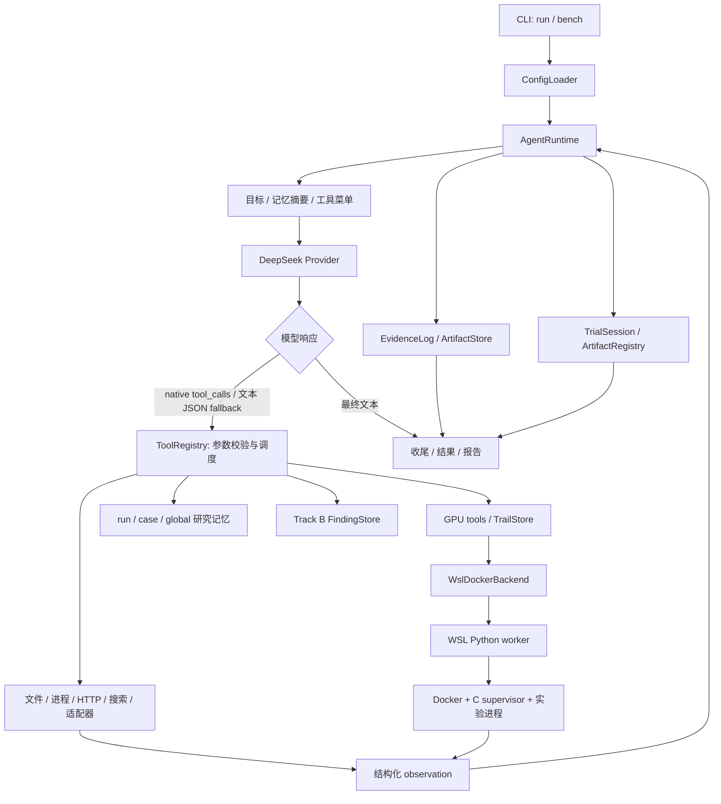

# GPUVulnAgent 工程接手说明

核对日期：2026-11-12。本文面向后续维护开发，依据当前源码、测试、Git 历史与实验归档编写；研究报告中的结论与本轮实际验证分开记录。

## 1. 当前工作基线

| 项目 | 本轮确认的状态 |
|---|---|
| 维护仓库 | [Qcx526/GPUVulnAgent](https://github.com/Qcx526/GPUVulnAgent) |
| 当前本地分支 | `research/cuda-vuln-sprint` |
| 当前 HEAD | `dbef9829bf3e22f30d38e0bf5201b8c10cb76a61` |
| 远端同名分支 | 与本地 HEAD 一致，已通过 `git ls-remote` 核对 |
| 默认分支 `main` | `ff207df1d41d8b4bdb2696f6716da217b5d02fea` |
| 当前分支相对 `main` | 多出 19 个提交，包含 GPU 后端、trial/artifact、findings 与后续研究 |
| GitHub 待处理事项 | 本轮查询未返回 open PR 或 open issue |
| 本地已有未跟踪目录 | `runs-p23r1/`、`runs-p23r2/`、`runs-sprint/`，本轮保留原状 |
| 包与解释器 | `gpuvulnagent 0.1.0`，声明 Python >=3.11；本机 `.venv` 为 Python 3.13.14 |
| 当前规模 | `gpuvulnagent/` 下 63 个 Python 文件、9,393 行；24 个测试模块 |

后续开发首先确认目标分支。直接从当前 `main` 开发会缺少本文涉及的许多模块。以上远端状态是本次检查的快照。

## 2. 工程解决的问题

这是一个自主 NVIDIA GPU / CUDA 用户态漏洞研究 agent。它接收自然语言目标，通过模型选择工具，查询资料、生成输入、编译执行、检查结果、积累研究记忆，最后产出可追溯的结论。

运行时采用单 agent 的开放式决策循环，没有预设“搜索→生成→执行”的固定阶段。工具与后端提供实验能力，具体假设、输入和执行顺序由模型决定。工程从 `cuda_poc_generator` 的固定历史版本迁移后独立维护，当前运行不依赖旧仓库。

判断项目能力时需分别看三层：agent 框架是否能运行、实验是否产生真实观测、观测是否足以支持某个 CVE。工具调用成功不代表目标漏洞复现成功；崩溃、跨版本差异、根因与 CVE 归属是不同的证据等级。

## 3. 架构与主调用链



| 模块 | 责任与主要入口 | 对应测试 |
|---|---|---|
| `cli.py`、`__main__.py` | `run/tools/doctor/memory/bench/verify` 六个子命令；run 参数组装 | `test_cli.py` |
| `config/loader.py` | 项目根定位、配置解析、类型检查、公开配置摘要 | `test_config.py` |
| `runtime/loop.py`、`state.py`、`protocol.py` | 决策循环、native/fallback、停止、resume、run 身份 | `test_runtime.py` |
| `providers/base.py`、`deepseek.py`、`tavily.py` | 统一响应与 usage；模型 HTTP 调用；可选搜索/提取 | `test_provider.py` |
| `registry/spec.py`、`registry.py` | `ParamSpec/ToolSpec`、JSON Schema、参数转换、统一执行 envelope | `test_registry.py` |
| `tools/build.py`、`discovery/` | 装配工具与能力目录；登记不可用能力及原因；工具链 manifest | `test_catalog.py`、`test_toolchain.py` |
| `tools/builtin.py`、`runtime/workspace.py` | 文件、宿主进程、HTTP、artifact、环境与记忆工具 | `test_evidence.py`、`test_runtime.py` |
| `backends/`、`tools/gpu.py` | WSL/Docker 协议、输入 staging、执行快照、回收、终止分类 | `test_gpu_tools.py`、`test_worker.py`、`test_wsl_backend.py`、`test_trails.py` |
| `evidence/` | hash chain、内容寻址存储、引用解析、进程与容器终止判定 | `test_evidence*.py`、`test_outcome.py`、`test_container_outcome.py` |
| `artifacts/` | trial 分配、产物 journal/index、自动收集、版本与父子关系、最终报告 | `test_artifact_lifecycle.py` |
| `memory/` | run/case/global JSONL、finding 引用校验、否证与提升 | `test_memory.py` |
| `adapters/elf_cubin/`、`adapters/jpeg/` | ELF/CUBIN 读取与工具链驱动；JPEG 结构读取、字段变异和配对对照 | `test_adapters.py` |
| `findings/`、`tools/findings.py` | Track B finding 创建、修订、报告与统计 | `test_findings.py` |
| `benchmarks/` | blind/seed case、独立 run、指标、保守 verdict、累计 summary | `test_benchmark.py` |

### 一次运行如何推进

1. `cli._cmd_run()` 检查 goal 和模型配置，构造 `DeepSeekProvider`；指定 `--sessions-dir` 时分配新的 `trialN`。
2. `AgentRuntime.__init__()` 创建或恢复 `RunState`，初始化 workspace、evidence、memory，并调用 `build_assembly()`。
3. 装配顺序是 builtin、适配器、可选 Tavily、GPU 后端、finding 工具，再形成 capability catalog。可选模块失败会记录原因并降级。
4. 初始提示包含目标、case、工作目录、证据路径、记忆摘要和工具菜单；每次模型请求还带原生工具 schema。
5. native `tool_calls` 为主路径，同一响应内的多个调用顺序执行。工具名、依赖与参数先经 registry 校验；调度拒绝会记录并反馈。handler 异常的反馈存在缺口，见第8节。
6. 没有 native 调用时尝试文本 JSON action；普通非空文本可作为最终回答。当前非法或未知工具 JSON 解析失败后，只要内容非空也会被当作最终回答。native 结果按相同 `tool_call_id` 回填 `role=tool`。
7. 每个执行形成 `Turn` 与 evidence record；trial 模式额外记录 transcript/tool_calls，并扫描新产物。observation 向模型暴露 `evidence_id`。
8. 运行因 final、决策数、墙钟、token、provider error 等停止；适用时还有一次不提供工具的收尾模型请求。最后写 `result.json`、run 状态与 trial 报告。

`decisions` 是循环中的模型决策数；`turns`/`executions` 是工具调用数。一条模型响应可产生多次工具调用，收尾模型请求不增加 `decisions`，所以二者不能互换。

resume 继承已有 `decisions`，因此 `--turns` 是总决策上限，不是追加轮数；墙钟重新计时，usage 则从零累计。

Provider 目前直接使用标准库 `urllib` 访问兼容 Chat Completions 的端点，无 LangChain 依赖。新增模型适配应实现 `Provider.chat()` 并返回 `ProviderResponse`，保留 tool-call 身份、usage、finish reason 等字段。

## 4. GPU 执行及信号证据

宿主链路为 `tools/gpu.py → WslDockerBackend → wsl.exe → worker/gpu_worker.py → docker → gpuvuln_supervise → 实验 argv`。Windows 与 WSL 之间通过 stdin/stdout 传 JSON；worker 响应有协议版本和边界标记。

worker 按结构化字段组装 Docker 选项，记录镜像身份、pull policy、容器身份、exit/OOM、supervision、快照和 cleanup。输入与输出两端都计算 SHA256，宿主接收产物时再次校验。每次执行使用单独的 `execNN` 快照，避免后一次容器执行覆盖前一次执行结果。

三处文件空间必须分清：

- `fs_write` 写 agent workspace，不会自动把文件交给容器。
- `trail_write` 登记 trail 输入。后端把输入暂存进 Linux work 目录，再挂载到 `/work`；实际路径以 staging 规则为准。
- 容器 `/work` 输出回传到该次执行的 `execs/execNN/outputs/`，不等于 agent workspace。

近期 sprint 的大量无效调用与上述路径预期不一致有关。今后改变 staging 时应同步工具描述、错误提示、测试和迁移说明，不能只改底层复制逻辑。

`gpuvuln_supervise.c` 用 `fork/execvp/waitpid` 记录直接子进程的真实 wait status。`exit(139)` 与被 SIGSEGV 杀死可以返回同一 Docker exit code，因此单独的 139 不能证明崩溃。缺少有效 supervisor 信号记录时，分类保留 `unverified_signal`，不计入确认 crash。

监督范围是直接子进程。如果 argv 是脚本、Python campaign 或 shell，内部另起的目标进程需要单独采集身份与终止证据；不能把外层成功或内部数字退出码直接升级为目标信号。

当前隔离边界以 README 的 scope 为准：宿主 `shell` 能使用用户权限执行命令；Docker 默认无网络、限制挂载和选项，但可显式申请 bridge/host 网络；WSL 共享主机 NVIDIA 驱动。该后端用于 CUDA 用户态实验，不能据此声称已隔离或验证内核态驱动漏洞。

## 5. 身份、目录与证据契约

| 对象 | 身份及用途 |
|---|---|
| case | 研究问题或指定 CVE；可跨 run |
| run | `run-<UTC时间>-<随机后缀>`；一次 runtime 状态与证据身份 |
| trial | `trialN`；人能打开的一次完整研究尝试，包含 session/research/poc/evidence/report |
| trail | `trailN`；某条实验方向的输入、manifest 与容器执行历史 |
| exec | `execNN`；某一次容器执行及其快照 |
| evidence | `<run_id>#<sequence>`；JSONL 中的单条观测记录，也支持 record hash 引用 |
| artifact | `art-...`；trial 内路径和内容哈希参与生成的产物记录，含 producer/parents/version |
| finding | `FND-<trial>-NNNN`；Track B 内部异常编号，不是 CVE 编号 |

新 trial 模式的典型实际布局如下。某些旧文档的布局与它不同，应沿运行代码和实际记录查找。

```text
runs/trialN/
  session/
    task.json / provenance.json / transcript.jsonl / decisions.jsonl / tool_calls.jsonl
    run/
      run.json / result.json / memory.jsonl / transcript.jsonl
      workspace/                         agent 写入文件
      artifacts/                         Evidence ArtifactStore
  evidence/
    evidence.jsonl                       trial 的主 hash chain
    artifact_index.jsonl                 ArtifactRegistry journal
    artifact_index.json                  物化索引
    trails/trailN/
      inputs/ / manifest.json
      execs/execNN/outputs/ / logs/ / result.json / snapshot.json
  research/findings.jsonl
  research/findings/<FND>.json / <FND>.md
  poc/INDEX.md / manifests/<artifact>.json
  report/final_report.md
```

普通 `--root` 模式和 benchmark 仍使用 `<run_dir>/evidence.jsonl`，不应把 trial 根直接当普通 run 根传给所有旧接口。

证据有三个不同的检查层：`verify_chain()` 验证 JSONL 的连续序号、前驱 hash 和内容 hash；`ArtifactRegistry.verify()` 验证登记产物的实际字节；`check_archive_integrity.py` 检查归档 manifest 的文件/hash/大小/Git 跟踪及漏列文件。通过其中一种不代表另外两种也通过，更不代表实验结论成立。

`ArtifactStore` 与 `ArtifactRegistry` 也不是同一组件。前者保存内容寻址的工具正文和日志，后者登记 trial 产物的来源、版本与父子关系。hash chain 具备篡改可检测性，不是外部签名或可信时间戳。

Memory 的 `finding` 类型与 Track B 的 `Finding` 数据模型相互独立。前者经 `EvidenceResolver` 检查引用是否存在；后者经 finding 工具登记。不能假设两条路径具有相同的验证强度。

## 6. 已有研究进展应如何解读

下面记录仓库现有证据及报告支持的范围；本轮未重新执行这些 PoC，也未独立复核外部公告的所有版本信息。

| 阶段 | 已完成事项 | 结论边界 |
|---|---|---|
| P17/P18、迁移 | agent 历史、原始 benchmark、旧实现问题审计及独立包初始化 | 历史归档用于追溯；旧报告的指标与 verdict 不能直接代替当前判据 |
| P19/P19-R1 | WSL/Docker/GPU 后端、执行快照、supervisor、symlink/timeout/pull/cleanup 验收 | 证明过基础设施能力；本轮仅验证现有文件，不重新认定机器当前 live 状态 |
| P20/P21 | agent 驱动 nvdisasm 研究、获取历史版本、初步差分实验 | 到达目标执行路径与出现异常不等于 UAF 机制或 CVE 归属成立 |
| P21R2 | trial 与 artifact 生命周期、CUDA 编译/执行、证据引用接通 | 具备会话及产物登记能力；当前实现仍有版本保留等缺口，见下一节 |
| P22/P23 | Track A/B 分离，稳定复查 `FND-t22-0001` | 报告记录 5 个版本各 5 次、共 25 次；12.6.68 为 supervisor 确认 SIGSEGV，其余版本正常拒绝。根因 partial、CVE 未归属，不能报成 CVE-2024-0124 已复现 |
| P23R1/R2-F0 | 自主变异与输入身份法证更正 | `FND-t0-0002` 原输入指错，已更正为 `reloc.cubin.reloc_sym_oob.bin`；#81/#83 只有未确认信号的 exit 139，不能认定 SIGSEGV |
| CUDA_RESEARCH_SPRINT | cuobjdump 资料研究、合法基线、mutator 准备；nvJPEG 只做范围梳理 | 没有执行 mutant，没有新确认 crash/differential/finding。结构化报告为 `stopped=token_budget`，顶层叙述仍称决策预算耗尽，二者不一致 |

Track A 是指定 CVE 的复现；Track B 是额外发现的异常。候选 `related_cves`、相似修复窗口、稳定崩溃都不能单独证明 CVE 归属。`benchmarks.metrics.verdict()` 对差分、机制和归属目前保守返回 `NOT_ESTABLISHED`，没有自动完成根因判定的引擎。

主要研究入口：`docs/P23_FINDINGS_REPORT.md`、`docs/P23_R1_FINDINGS_REPORT.md`、`docs/P23R2_F0_FORENSIC_REPORT.md`、`research_archive/experiments/CUDA_RESEARCH_SPRINT/FINAL_REPORT.md`。结论冲突时继续核对原始 evidence、执行结果和输入 SHA256。

## 7. 本轮实测结果

运行命令：` .venv\Scripts\python.exe -m pytest `。

结果：**243 passed，7 skipped，1 failed，19.39 秒**。7 项跳过的是需 `GPUVULNAGENT_LIVE=1` 的真实 WSL/Docker/GPU 测试。

唯一失败：`tests/test_archive_integrity.py::test_bundle_is_internally_consistent[CUDA_RESEARCH_SPRINT]`。该 bundle 的 `FINAL_REPORT.md`、`POC_CATALOG.md` 是实际存在的普通文件，却未列入 `bundle_manifest.json`。

另完成以下只读检查：

- `research_archive/experiments/` 下当前全部 5 份 `evidence.jsonl` 的 hash chain 通过：sprint 88 条、P19 47 条、P20 两份分别 76/34 条、P23R1 106 条。
- `toolchains/manifests/toolchain_manifest.json` 声明的全部 12 项文件 SHA256 与本机文件一致。该检查未运行二进制，不证明依赖和 GPU 环境可用。
- 读取 GitHub 仓库信息与 README，核对 main/current branch 的远端提交；检查现有测试、配置、迁移与研究文档。
- 在临时目录以合成数据复核了 artifact 第三版覆盖、产物来源误标、目标 exit 0 掩盖采集错误、staging 目的端 symlink 等契约问题；没有调用真实实验后端。
- 本轮本地检查快照存于 `.local/onboarding/inspection.json`，不包含凭证。

未进行：真实模型请求、Tavily 请求、WSL/Docker/GPU 重新验收、目标 PoC 执行、wheel 构建或安装验证。本机虚拟环境未安装 setuptools/wheel/build，打包风险是配置静态检查的结果。

## 8. 接手后需要优先处理的缺口

以下是开发待办，不是本轮已修复内容。依据包括代码、现有测试和临时目录内的离线契约复核；涉及部署或外部运行的影响仍需对应集成验证。

| 范围 | 当前事实与影响 | 定位 |
|---|---|---|
| 归档完整性 | sprint 两份顶层报告未入 manifest，导致当前测试失败；报告称脚本已归档，但 bundle 没有独立 `mutate.py/base.cu/base.cubin`，仅部分内容可从 tool_calls 恢复，本机 runs 目录另有文件 | sprint `bundle_manifest.json`、`FINAL_REPORT.md`、`POC_CATALOG.md` |
| Finding 降级 | `FND-t0-0002` 的 notes 已写 unverified，但 JSON 的 title/crash_class/signal/differential 仍写 SIGSEGV，verification_status 为 new；`STATUSES` 没有 unverified，传入后也会归一成 new | `findings/model.py:27`、`:68`；P23R1 `findings/FND-t0-0002.json` |
| Finding 统计 | `root_cause_done` 包含 partial；`linked_to_known_cve` 与 `unattributed` 仅凭 `related_cves` 是否非空计数，无法区分候选与已确认归属 | `findings/store.py:93` |
| 产物旧版本 | `register()`/自动 harvest 只登记新 hash，同一路径被覆盖时旧字节并未保存；现有测试明确接受旧版本 verify 失败。`register_bytes()` 虽尝试选新文件名，连续三次同名写入仍会复用 `_v002` 并覆盖第二版，已离线复核 | `artifacts/registry.py:83`、`:123`、`trial.py:158`；`test_artifact_lifecycle.py:48` |
| 产物来源 | `_classify_origin()` 的 trail 解析只识别以 `trails/` 开头的路径，实际 trial 使用 `evidence/trails/`；execution_id 会退化为 `trail/execNN`。binary 来源还依赖旧 registry 搜索，首次编译产物可能标为 generated | `artifacts/trial.py:199` |
| 输入产物登记 | harvest 扫 workspace 和 exec outputs，不扫 trail inputs；未修改的输入也不进入 delta outputs。因此 `trail_write` 写入的源文件不一定进入 PoC registry，binary parent 链可能缺失 | `runtime/loop.py:406`、`artifacts/trial.py:158` |
| token 预算 | 成功响应返回后累计 usage，仅在 `total > max_tokens` 时停止；没有收窄本次请求 token，上限等于阈值时仍可再请求，收尾请求还能继续消费。usage 缺失视为 0；resume 时 usage 重置；超限响应在 assistant evidence 写入前被丢弃 | `runtime/loop.py:230`、`:419`；`providers/deepseek.py:52` |
| 墙钟与恢复 | Runner 有 deadline，但 provider 重试每次仍用同一 timeout，网络/探测/GPU 等路径未统一使用 run 剩余时间。resume 严格比较 state head 和 log tail，崩溃前已 append、未 save 的合法新增记录也可能被拒绝 | `runtime/loop.py`、`runtime/state.py:109`、`providers/deepseek.py:75` |
| WSL 根配置 | 宿主用配置的 worker_root 放脚本，但 worker 的运行根读取 `GPUVULN_WORKER_ROOT` 或默认值；启动未显式传入该变量，自定义 `WSL_WORKER_ROOT` 可能只改变脚本位置 | `backends/wsl_docker.py`、`backends/worker/gpu_worker.py` |
| 结果完整性 | backend 的成功判据主要取 target termination；合成 worker 结果为 exit 0、snapshot error、cleanup_ok=false 时，仍返回 ok=true，已离线复核。summary 未统一提升 result.error，不能把工具 ok 解释为产物与回收均完整 | `backends/wsl_docker.py:278`、`backends/base.py`、`tools/gpu.py` |
| staging 路径 | 采集端拒绝 symlink，但输入 `op_prepare()` 直接 `copy2` 到已有 work 目标；若目的端为上次实验留下的 symlink，会先跟随写入，再在 hash 检查时报错。已在临时目录复核，采集端保护不能外推到 staging | `backends/worker/gpu_worker.py:344` |
| 调度反馈与参数 | handler 抛异常后 envelope 有 error，但 runtime 因 dispatched=true 只向模型反馈 result=null。数组 items_type 主要进入 schema，未统一校验元素；非字符串 enum 校验也有缺口。需要使 schema、调度和模型可见错误一致 | `registry/spec.py`、`registry/registry.py:95`、`runtime/loop.py:262` |
| 发布配置 | 显式 setuptools packages 缺少 `gpuvulnagent.artifacts`、`gpuvulnagent.findings`；package-data 未声明 supervisor C 源码。源码/editable 可运行不代表 wheel 可运行 | `pyproject.toml` |
| 多种布局 | CLI verify 和 metrics 固定读取传入目录下的 `evidence.jsonl`。benchmark 自身使用普通 run，因此目前正常；不能直接用这些接口读取 trial 根 | `cli.py:253`、`benchmarks/metrics.py:34` |
| 脱敏范围 | Runner、部分网络/provider 路径有 redact，但 EvidenceLog.append、runtime transcript/result、fs 工具正文等没有统一脱敏入口。README 的全量落盘前脱敏承诺需要逐路径验证 | `evidence/log.py`、`runtime/loop.py`、`tools/builtin.py` |
| 重复与仓库卫生 | runtime 末尾重复 harvest/finish；TrialSession 重复 provenance 定义/调用；已有 59 个 `.pyc` 被 Git 跟踪，ignore 不会取消既有跟踪；`runs-*` 未被当前 `runs/` 规则覆盖 | `runtime/loop.py:336`、`artifacts/trial.py:97`、`.gitignore` |

建议处理顺序：先恢复归档测试通过并校正 finding 的机器字段；再落实产物不可变性、staging 与结果完整性、预算/恢复契约；随后补打包、路径配置和跨布局集成验证。每项修改都要保留原始证据，通过追加更正表达历史变化。

## 9. 配置、运行与验证入口

配置优先级为非空进程环境 > 项目根 `.env` > `configs/default.yaml` > 内建默认值。基础依赖为 PyYAML；Tavily/Pillow/pyelftools/pytest 分别在可选依赖组。工具链大二进制通常不入 Git，manifest 记录版本、hash、来源和依赖。

常用命令（在项目根 PowerShell 执行；真实请求或实验按具体开发任务运行）：

```powershell
# 离线回归
.\.venv\Scripts\python.exe -m pytest

# 工具与配置诊断；catalog/manifest 部分检查可能启动工具做版本探测
.\.venv\Scripts\python.exe -m gpuvulnagent doctor --verify-toolchain
.\.venv\Scripts\python.exe -m gpuvulnagent tools --search docker
.\.venv\Scripts\python.exe -m gpuvulnagent tools --describe container_exec

# 新研究使用新的 trial；下面是运行示例，不是本轮已执行操作
.\.venv\Scripts\python.exe -m gpuvulnagent run --goal-file <目标文件> --case <case-id> --sessions-dir runs --turns 12

# 普通 run 的证据链
.\.venv\Scripts\python.exe -m gpuvulnagent verify --run <普通run目录>

# 当前 CLI 对 trial 的适配方式：传 evidence 目录，使其找到 evidence.jsonl
.\.venv\Scripts\python.exe -m gpuvulnagent verify --run runs/trialN/evidence

# 实验归档完整性；当前 sprint 会因第7节的问题失败
.\.venv\Scripts\python.exe scripts/check_archive_integrity.py

# 真实后端回归，单独启用
$env:GPUVULNAGENT_LIVE = '1'
.\.venv\Scripts\python.exe -m pytest tests/test_live_gpu_backend.py
Remove-Item Env:GPUVULNAGENT_LIVE
```

真实端点验收入口为 `scripts/acceptance.py`；GPU 后端历史验收入口为 `scripts/p19_acceptance.py` 和 `scripts/p19r1_acceptance.py`。`p21r2_trial4_acceptance.py` 绑定特定历史 trial/run，不宜直接用作通用验收脚本。`setup_toolchain.py` 也包含原机器采集路径，迁移机器前需检查。

## 10. 后续改动应落在哪一层

| 开发目标 | 首要改动位置 | 应验证的行为 |
|---|---|---|
| 换模型或端点 | `providers/` 与 CLI provider 构造 | native tool_calls、多调用、usage、错误/重试、收尾 |
| 新增普通工具 | `ToolSpec/ParamSpec`，对应工具 builder，`tools/build.py` | schema、校验/拒绝、ok/envelope、evidence 与 catalog |
| 新增文件格式能力 | `adapters/<format>/`、`adapters/__init__.py` | 不可用能力仍可发现、配对对照、输入输出身份 |
| 改 GPU 运行或部署 | `backends/`、`tools/gpu.py` | JSON 协议、配置传递、staging、timeout、supervisor、快照/回收 |
| 改证据或产物 | `evidence/`、`artifacts/` | 内容不丢失、可解析引用、跨布局、历史兼容、报告与索引一致 |
| 改研究结论或统计 | `findings/`、`benchmarks/` | A/B 分离、未确认状态、候选/确认归属区分、原始证据可核对 |
| 优化 agent 研究效率 | `context/`、工具描述、runtime 反馈与记忆 | 是否更早执行有效实验、减少参数/路径错误；不能只看报告篇幅 |

已有离线测试使用 `tests/support.py` 的 ScriptedProvider 和 backend mock，不需要真实 API key。改动时先运行相关模块测试及既有完整性检查；涉及 WSL/GPU 协议、信号或快照的改动，再单独进行真实后端验收。研究效果应依照“实际执行→路径到达→崩溃→同字节差分→机制→归属”逐级核对。
